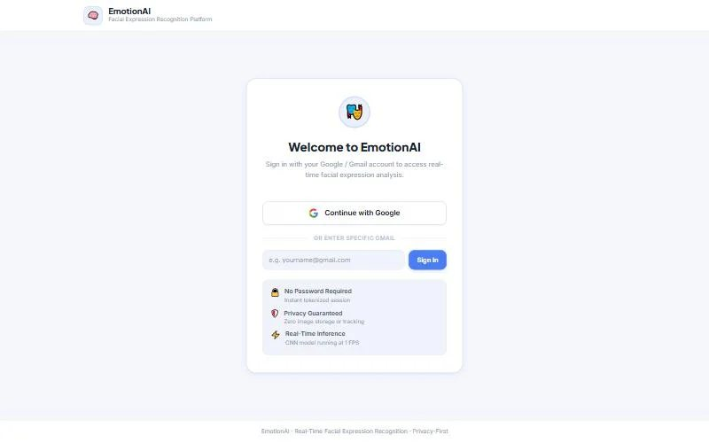
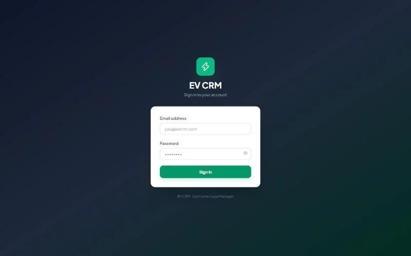
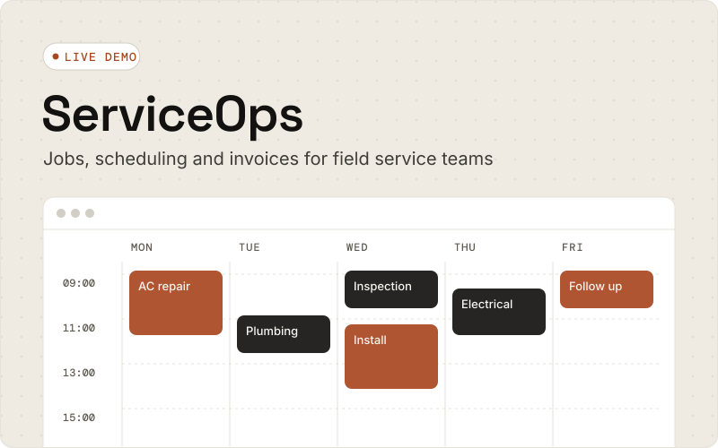
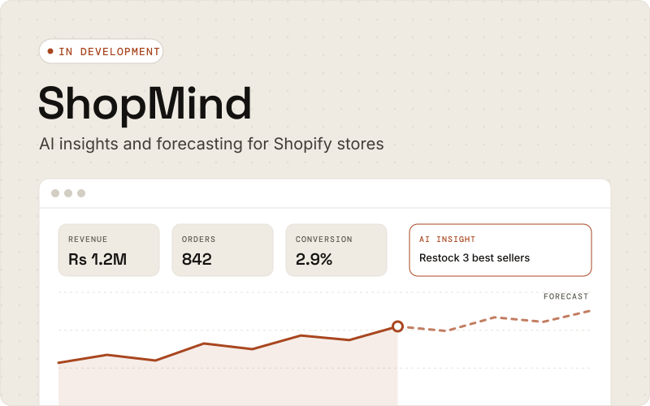
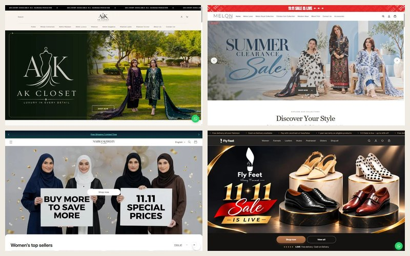

<picture>
  <source media="(prefers-color-scheme: dark)" srcset="assets/banner-dark.svg">
  
</picture>

  
  
  

## About

I'm a Software Engineering graduate from UIT University, Karachi. I build Shopify storefronts for fashion and footwear brands, and full stack and AI products for real business workflows.

- **Shopify:** custom themes, Liquid sections, storefront UX and mobile page speed
- **Full stack:** business tools built with Next.js, FastAPI and PostgreSQL
- **AI and computer vision:** OpenCV, YOLOv8 and TensorFlow projects you can try live

## Featured projects

<table>
  <tr>
    <td width="50%" valign="top">
      
      <h3>ProctorVision</h3>
      
Exam proctoring for university halls. YOLOv8 pose estimation flags suspicious behavior from a single CCTV camera and saves evidence for invigilators.

      
<code>Python</code> <code>YOLOv8</code> <code>OpenCV</code> <code>Flask</code>

      
<a href="https://ahmedmuarij.github.io/ProctorVision/"><b>Website</b></a> · <a href="https://github.com/AhmedMuarij/ProctorVision">Source code</a>

    </td>
    <td width="50%" valign="top">
      
      <h3>EmotionAI</h3>
      
Facial expression recognition in the browser. A custom CNN served by FastAPI, with a Next.js dashboard that shows live predictions from the webcam.

      
<code>TensorFlow</code> <code>OpenCV</code> <code>FastAPI</code> <code>Next.js</code>

      
<a href="https://emotion-detector-henna.vercel.app/"><b>Live demo</b></a> · <a href="https://github.com/AhmedMuarij/Emotion_Detector">Source code</a>

    </td>
  </tr>
  <tr>
    <td width="50%" valign="top">
      
      <h3>Lead Generation CRM</h3>
      
A CRM for an EV call center. Sales teams capture leads, manage the pipeline, schedule follow ups and track every interaction in one place.

      
<code>Next.js</code> <code>FastAPI</code> <code>PostgreSQL</code> <code>TypeScript</code>

      
<a href="https://crm-frontend-seven-mu.vercel.app/login"><b>Live app</b></a> · <a href="https://github.com/AhmedMuarij/CRM_For-lead-generation">Source code</a>

    </td>
    <td width="50%" valign="top">
      
      <h3>ServiceOps</h3>
      
Service management for small field service businesses. Customers, jobs, scheduling, technicians and invoices in one workspace, with AI that suggests but never writes.

      
<code>Next.js</code> <code>Prisma</code> <code>PostgreSQL</code> <code>TypeScript</code>

      
<a href="https://service-desktop.vercel.app/"><b>Live demo</b></a> · <a href="https://github.com/AhmedMuarij/ServiceDesk">Source code</a>

    </td>
  </tr>
  <tr>
    <td width="50%" valign="top">
      
      <h3>ShopMind</h3>
      
AI analytics for Shopify stores. It syncs store data, forecasts demand and explains what is happening and what to do next. Currently in development.

      
<code>FastAPI</code> <code>PostgreSQL</code> <code>Next.js</code> <code>Machine learning</code>

      
<a href="https://github.com/AhmedMuarij/ShopMind"><b>Source code</b></a>

    </td>
    <td width="50%" valign="top">
      
      <h3>Shopify storefronts</h3>
      
Store redesigns, theme customization and custom Liquid sections for fashion and footwear brands, focused on mobile shopping and a shorter path to checkout.

      
<code>Shopify</code> <code>Liquid</code> <code>HTML</code> <code>CSS</code> <code>JavaScript</code>

      
<a href="https://akcloset.com/">AK Closet</a> · <a href="https://melonbyanam.com/">Melon by Anam</a> · <a href="https://www.marwamodesty.com/">Marwa Modesty</a> · <a href="https://theflyfeet.com/">Fly Feet</a> · <a href="https://lumaa.pk/">LUMAA</a>

    </td>
  </tr>
</table>

## Machine learning projects

| Project | What it does |
| :-- | :-- |
| [Loan Prediction](https://github.com/AhmedMuarij/Loan-Prediction) | Predicts loan approval with Logistic Regression, Decision Tree, Random Forest and XGBoost |
| [Student Performance Prediction](https://github.com/AhmedMuarij/Student-Performance-Prediction) | Predicts exam scores with regression and groups students with clustering |
| [Customer Segmentation](https://github.com/AhmedMuarij/customer-segmentation) | Segments shoppers with K Means clustering on the Mall Customers dataset |
| [Forest Cover Classification](https://github.com/AhmedMuarij/Forest-Cover-Classification) | Classifies forest cover types from the UCI Covertype dataset |

## Tech stack

  

| Ecommerce | Frontend | Backend and data | AI and tools |
| :-- | :-- | :-- | :-- |
| Shopify, Liquid, theme customization, storefront UX | HTML, CSS, JavaScript, TypeScript, React, Next.js | Python, FastAPI, Flask, PostgreSQL, SQL, Prisma, Supabase | TensorFlow, OpenCV, YOLOv8, Git, Vercel |

## Let's work together

I'm open to Shopify projects and software engineering roles. Email is the quickest way to reach me: **[ahmedmuarij05@gmail.com](mailto:ahmedmuarij05@gmail.com)**

You can see more of my work on my [portfolio](https://ahmed-muarij-portfolio.vercel.app/) and connect with me on [LinkedIn](https://www.linkedin.com/in/ahmed-muarij-siddiqui/).
